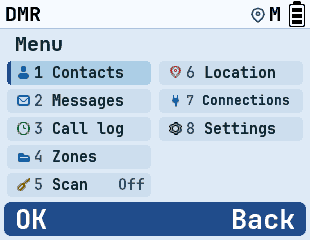
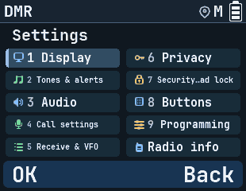
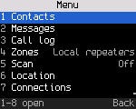
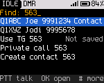
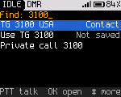

<!-- SPDX-License-Identifier: MIT -->

# Keys and Navigation

Each key does the same kind of thing on every screen.

## The five rules

1. **OK** opens or chooses the thing with the focus. Holding **OK** does the lasting version, such as save or make
   permanent.
2. **Back** goes back one level. On Home it undoes one temporary change per press. Holding **Back** returns to Home
   from anywhere.
3. **\*** opens quick settings for what you are doing. Holding **\*** locks or unlocks the keys.
4. **#** opens the actions for the thing with the focus, such as a person, a talkgroup, a message or the last caller.
   Holding **#** opens the talk target picker on a DMR channel.
5. **PTT** talks to the person or talkgroup with the focus in any list, once. With nothing focused, it talks to the
   channel's talk target.

The bottom line of most screens is the hint row. It shows what the nearest keys do there. What **Back** does is at
its right end, above the **Back** key. In the Panels look the bottom bar names the two soft keys, **OK** on the left
and **Back** on the right, and the line above it shows the hints for the other keys. **Settings > Display > Hint row**
hides that line; the bar stays.

Menus initially select the first available item. You can still move to a dimmed item and press **OK** to see why
it is unavailable. **Back** restores your previous menu selection.

## Key reference

The keys are named by their job ([Conventions](01-introduction.md#conventions-in-this-manual)).
[Key roles](23-radios.md#key-roles) lists which physical key does each job on your radio. It also lists what replaces
a key the radio doesn't have.

| Key | Press | Hold |
|---|---|---|
| **OK** | Home: open Menu. Lists: open or choose | Save or make permanent |
| **Back** | Back one level. Home: undo one temporary change | Home |
| **Up**, **Down** | Move the focus. Home: next or previous channel (VFO: frequency step), or zone or talk target with **Settings > Buttons > Up/Down on Home** (the channel knob stays on the channel). Editors: change the value | Repeats |
| **\*** | Quick settings. While you transmit on FM with **PTT**: its [touch tone](08-fm.md#touch-tones-dtmf) | Lock or unlock the keys |
| **#** | While you transmit on FM with **PTT**: its [touch tone](08-fm.md#touch-tones-dtmf). Otherwise: actions for the focused item. Home: actions for the last caller. VFO: tunes a frequency being typed, as **OK** | DMR channels: the talk target picker (pick a talkgroup, or type an ID). The call log is **OK**, **3** |
| **0** to **9** | Home: start Find. Lists: pick a numbered row, or type to filter. VFO: type a frequency. While you transmit with **PTT**: FM sends the key's [touch tone](08-fm.md#touch-tones-dtmf), DMR nothing | Home: speed dial (not built yet). While you transmit with **PTT**: as a press |
| **Previous zone**, **Next zone** | Home: previous or next zone | |
| **Monitor** | FM: opens the squelch while held. DMR: digital monitor (every talkgroup) on or off | |
| **Talk target** | Talk target picker (DMR channels) | Dual watch on or off |
| **Power level** | Home: next power level | Hold 1.5 s: emergency ([Emergency](11-emergency.md)) |
| **PTT** | Transmit | |
| Channel knob | Each click is one step. Clockwise: the next channel on Home (as **Up**), the next row down in a list or menu, a higher value in an editor. Counterclockwise: the opposite | |

The side keys (**Monitor**, **Talk target** and **Power level** on most radios) can do other jobs. Set them in
**Settings > Buttons** ([Settings](17-settings.md#buttons-key-8)) or in the codeplug.

Each key press gives a short key beep unless **Settings > Tones & alerts > Key tones** is off.

While the keys are locked (hold **\***), **PTT** still works. When **Settings > Security & keypad lock > PTT when locked** is off,
**PTT** gives an error beep and "PTT is off while locked: hold * to unlock".

## Moving around

The Home screen is the base. Every other screen is at most three levels away from it.

```
Home
 |-- *            Quick settings
 |-- OK           Menu, a 3x3 grid that matches the keypad:
 |                    1 Contacts      2 Messages      3 Call log
 |                    4 Zones         5 Scan          6 Location
 |                    7 Connections   8 Settings      9 (empty)
 |                    (a radio without # gets 0 Last caller at the top)
 |-- #            Actions for the last caller
 |-- hold #       Talk target picker (DMR)
 |-- 0-9          Find
 '-- Talk target  Talk target picker
```

| Menu entry | What is inside |
|---|---|
| 1 Contacts | Talkgroups and people, type to find ([DMR](09-dmr.md#contacts)) |
| 2 Messages | Messages, newest first; a zone or channel another radio offers, while the offer waits (**Zone offers**) |
| 3 Call log | Stations heard and calls made, newest first |
| 4 Zones | The VFO and the zones; a zone's channels with **#** ([Zones](07-channels-zones-vfo.md)) |
| 5 Scan | 1 Scan on or off ([Scan](12-scan.md)), 2 Roaming ([DMR](09-dmr.md#roaming)) |
| 6 Location | 1 GPS status, 2 APRS ([APRS](13-aprs.md)), 3 Satellite (where built, [Satellite](18-satellite.md)), 4 Location settings |
| 7 Connections | 1 Hotspot ([Hotspot](14-hotspot.md)), 2 USB network ([USB network](15-usb-network.md)), 3 SFR, 4 Data services (where built), 5 PC and network |
| 8 Settings | Nine groups and Radio info ([Settings](17-settings.md)). Channels, zone editing, Diagnostics and Factory reset are in **Settings > Programming** |

Menu's entries show what they hold: the number of unread messages, the zone in use, a scan that runs. Where a value
doesn't fit beside the name, it is shortened or left out.

In numbered lists (Menu, Scan, Location, Connections, Settings, actions, quick settings) a number key picks the row
with that number directly. For example, **OK**, **7** opens Connections. An entry a radio doesn't have is left out, and
the others keep their numbers.

In the Panels look, list rows are rounded panels of one height, and the highlighted row is filled, with a bar in the
accent color at its left end. Menu is a 3 x 3 grid of tiles laid out like the number keys, and the first level of
Settings shows two columns of three tiles. **Up** and **Down** follow the numbers, then move to the next page. Where a
list has more entries than fit, the title shows the highlighted entry's position, for example **3/12**. All eight Menu
entries fit on one page, and **8** opens Settings directly. **OK** opens the highlighted item, and **Back** returns to
the previous screen.




Each Menu and Settings tile has an icon. The status bar at the top is the same as on Home, and the bottom bar shows the
labels of the two soft keys: **OK** on the left and **Back** on the right. On a small screen (under 220 pixels wide or under 200 pixels high),
the tiles show their icon and number, and the title names the highlighted tile. A list there can show one more row when
the hint row is off or has nothing to show, and the highlighted row slides sideways to show a name that is too long
for it.

In long lists (Contacts, Channels, a zone's channels) the number keys filter the list by name, the way a phone
keypad spells words. **2** is ABC, **3** is DEF, and so on to **9** (WXYZ). Each key narrows the list to names with a
word that starts with those letters. **Back** deletes the last key typed, then leaves the list.



## Find

On Home (not in the VFO), a number key opens Find. Find searches everything at once. Type digits. Find lists, in
this order:

1. The channel at that position in the current zone. "12" lists channel 12.
2. The digits as a frequency in one of the radio's bands, read as in the VFO: "438250" lists "Tune VFO to 438.250".
   **OK** opens the VFO on it. The VFO's mode, power and tones stay as they were.
3. Channels in the zone, contacts and talkgroups, zones, places (Menu's entries, such as Contacts and Location) and
   settings whose names match the keys as letters (up to three settings, the ones you can change before Radio
   info's values). Settings, **0** opens Find too.
4. Contacts whose DMR ID starts with the number, from three digits on.
5. The number itself, as a talkgroup ("Use TG 3100", "not saved") and as a private call ("Private call 3100").
6. "Create contact 3100" when no contact has that ID. **OK** opens New Contact ([Contacts](09-dmr.md#contacts)).

Then:

| Key | Does |
|---|---|
| **OK** | Go to the channel or zone, tune the VFO, open the place, open a setting where it lives (**Back** goes up through the pages on the way), talk to the talkgroup or person for now, or create the contact |
| **PTT** | Talk to the focused talkgroup or person once |
| **#** | Actions for the focused talkgroup or person |
| **Back** | Delete the last digit. With one digit left, leave Find |

Settings also answer to other names. For example, "promiscuous" finds DMR monitor at start and "TOT" finds TX timeout.




## Temporary and permanent changes

Changes you make while operating (power, squelch, tone, timeslot, color code, mode, talk target) are temporary. They
last until you change the channel or press **Back** on Home. Home marks the changed fields. To keep a change in the
channel, hold **OK** on Home or in quick settings. The radio shows "Saved to channel".
In the VFO, changes are kept automatically, so a hold says "VFO settings save automatically". Squelch is one
setting for the whole radio, so squelch set in the VFO becomes the default squelch on every channel too (the same as
holding **OK** to save it on a channel). If another
write is in progress, it says "Save busy: try again"; wait a moment and hold **OK** again.

**Back** on Home clears one thing per press, in this order:

1. a frequency being typed
2. a banner
3. the scan
4. the reply window
5. digital monitor
6. all temporary changes together ("Changes undone")

## Key lock

On Home, hold **\*** to lock the keys. The screen shows "Keys locked: hold * to unlock" and an "L" in the status line.
While locked, **PTT** and **Monitor** still work. Any other key, and the channel knob, shows the unlock hint. Hold
**\*** again to unlock. The volume knob still works, unless **Settings > Security & keypad lock > Knob when locked** is Off.
In menus holding **\*** doesn't lock, so a slow press can't lock the keys in the middle of a task.

**Settings > Security & keypad lock > Auto lock** locks the keys by itself after a time without a key press. A radio with only
side keys (no keypad, no Back key) never locks by itself: nothing could unlock it.


## Toasts and banners

Short messages ("toasts") appear in the hint row for about two seconds. A toast shows the result of an action, or why
something isn't available. A long toast takes a second line above the hint row and isn't cut short. Banners announce
events (a message, a call alert, a radio check result) for eight seconds. While a
banner about a message or a call alert is up, **#** opens what it is about. **Back** on Home hides it.
