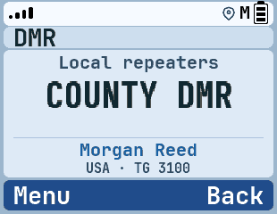
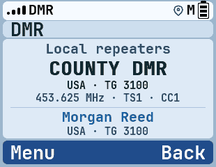
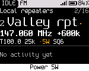

<!-- SPDX-License-Identifier: MIT -->

# The Home Screen

Home answers four questions at a glance: where you are, what **PTT** will do, what is happening, and whether the radio
is OK.

## Commercial and Amateur Home

On supported color displays, **Settings > Display > Display Profile** selects **Commercial** or **Amateur**.
Both center the zone and the named talk target. On FM, the channel name takes the place of the talk target.

| Profile | What you see |
|---|---|
| Commercial (default) | Larger zone and talk target text and a taller status bar. On a named DMR talkgroup, the frequency, numeric talkgroup ID, timeslot, and color code are omitted. If a DMR target has no name, its ID identifies it. In the VFO, the frequency identifies the channel |
| Amateur | The same zone and talk target, plus the channel, receive frequency, and DMR talkgroup ID, timeslot, and color code as applicable. **Large text** hides the extra details |

The four rounded panes hold device status, operating mode and its indicators, the channel, and the key labels.
During a DMR call, the talker alias appears below the talk target when the radio has the alias and
**Settings > Talk & listen > Show talker alias** is on. The zone and talk target stay in place at the same size.
During a voice transmission, **TX** appears in the device bar, and the channel pane shows the time remaining
if a transmit timeout is set.

| Place | Indicator | Meaning |
|---|---|---|
| Device bar | Signal bars | Reception is active. The bars clear when reception ends. In Dual Watch they follow the audible receiver |
| Device bar | A and B in boxes | Dual Watch is active |
| Device bar | VOX | Voice-operated transmit is armed |
| Device bar | GPS pin | The GPS receiver has a fix |
| Device bar | Lock | The keys are locked |
| Device bar | L, M, H | Low, medium, or high transmit power |
| Device bar | Battery | Filled segments show charge. The icon changes color at the low battery threshold |
| Operating row | Mode text | The channel mode, for example FM or DMR |
| Operating row | R inside a circular arrow | Roaming is active. The arrow rotates while the radio searches or surveys |
| Operating row | Zigzag arrow | Scan is on. The highlight travels along the line and ends at the arrowhead |
| Operating row | Green key | DMR encryption is configured. An AES channel adds the **AES** label |
| Operating row | Key with a red X | The radio hears encrypted traffic that does not match its configuration or that it cannot decrypt. A clear channel leaves the key slot blank while idle |
| Operating row | Envelope | An unread message is waiting |
| Operating row | Speaker with one wave | FM monitor or DMR digital monitor is on |
| Operating row | RX | The channel is receive-only |

With **Settings > Display > GPS clock** on, idle Home stacks the date and UTC time at the right of the operating row.
That space stays blank until a valid fix supplies date and time, and clears if the fix is lost. **Day/Night** changes
the palette on Home and in menus. See [Display settings](17-settings.md#display-key-2) for defaults.

The screenshots above show the channel view. Dual Watch has its own two-channel view, and trunked channels have their
own operating display. The tables below describe the standard Home layout also used on displays without profile support.

## Regions, top to bottom

| Region | Shows |
|---|---|
| Status line | Left: the state (IDLE, RX, TX, or NO TX when a transmission is refused; RX whenever the squelch is open, monitor included), the mode (DMR or FM), SCAN or MON when scan or monitor is on, and IP while USB is a network adapter, with an up and a down arrow after it once the computer has connected to it. Right: "L" when the keys are locked, "M" and a number for unread messages, a satellite dish on a radio with GPS (hollow while GPS is off, solid while it searches, with its feed arm and waves once it has a fix), the signal bars, the battery icon and the battery percentage. On a color screen the line is filled with the highlight color, its text black (Settings > Display > Filled status bar) |
| Place | The zone name and the channel's position in the zone ("3/16"). In the VFO: "VFO" |
| Channel | The channel number and name, as large as they fit. In the VFO: the frequency |
| Talk target | DMR: an arrow and where **PTT** goes, a talkgroup or person, as "TG 91 World"; a name too long to fit is cut ("TG 201 Main O…") before the name is dropped. FM channel: the frequency the channel listens on, then a repeater's offset when the row has room ("147.060 MHz +600k"), with no arrow. On FM, while you hold **PTT**, and in the VFO (where the large frequency is the receive frequency), an arrow and the transmit frequency. Trunked P25 channel: what the radio is doing ([P25 trunked channels](07-channels-zones-vfo.md#p25-trunked-channels)), and "RX only", in the warning color, while it waits on a system it can't transmit on. During the reply window: a return arrow in a filled box, and a countdown. To read the talkgroup's name first ("World TG 91"), turn on **Settings > Display > Talkgroup name first**, or give a side key **TG name / number** (Settings > Keys) |
| Chips | DMR: timeslot, color code, "Rpt" on a repeater channel, power (the signal bars show when the repeater is heard). FM: tone, bandwidth, power, squelch level |
| Activity | Idle: the last station heard and how long ago, or "No calls heard yet". A setting the radio needs before it can transmit comes first, in the warning color ("Set: Board revision", or "Restart to apply"), with the hint row saying where to set it. Receiving or transmitting: see below |
| Hint row | What the nearest keys do now |

A field changed for now (a temporary change) is drawn in a highlight color on Home, and the hint row says
"Back undo  Hold OK save".

The battery percentage turns to the warning color at the low battery warning level (15 % by default) and below.

## Hint row messages

The hint row changes with the situation. When the right soft key can be assigned on Home, the left label is
**Menu** and the right label shows its short-press function from **Settings > Keys**. **Nothing** leaves the
right label blank. While entering a frequency or when the keys are locked, the row shows the controls for that state.

The most common hints:

| Hint | Meaning |
|---|---|
| OK Menu  \* Quick  # Joe | The normal hint. The name after # is the last caller. **#** opens actions for them |
| Back undo  Hold OK save | The channel has temporary changes |
| # caller  Back end reply | The reply window is running. **PTT** answers the last call |
| Back: channel's talkgroup | A talk target chosen for now is in use ("Back default target" where the row is narrow) |
| Digital monitor  Back off | Digital monitor is on |
| # skip  Back stop scan | Scan is running |
| No codec: voice off | DMR channel without the codec merged |
| 0-9 freq  \* Quick  Up/Dn | In the VFO |
| Keys locked: hold \* to unlock | The keys are locked ("Locked: hold \* to unlock" where the row is narrow) |

## Receiving

During a DMR call, Home shows the caller:

- the name, from your contacts or else from the DMR ID database in the codeplug;
- the DMR ID and the timeslot;
- the talker alias as it arrives, unless **Settings > Talk & listen > Show talker alias** is off;
- the talkgroup, or "Private to you";
- the signal strength (in DMR, the peak of the last 120 ms, so the empty timeslot doesn't show as a drop).

A call that the radio hears but doesn't play shows why. The reasons are "Other TG: not played" (a talkgroup you don't
listen to), "Encrypted: not played" and "No codec: voice off". Hold **Monitor** to hear a call on another talkgroup.

On FM, the activity region shows "Receiving" while the squelch is open, or "Squelch open" (monitor).

## Transmitting

While you hold **PTT**, the screen shows TALKING, the target, the timeslot and color code (DMR), the time on air and
the transmit timeout. DMR shows the time as "0:07 of 3:00", FM as "2:53 left of 3:00".

On DMR the top line says what kind of call it is: "TG 3100" for a group call, "Private 9991234" for a private call.
A private call shows the contact's name, and its ID when there is room. A name too long for the line keeps the name
and drops the ID.

On DMR the screen may first show WAITING (the radio waits for a free slot) or WAKING RPT (it wakes up the repeater).
While it wakes the repeater, the red LED blinks once for each wake-up signal it sends, and lights steady once you are
on the air.

The radio also transmits without PTT on DMR: registration (ARS), text messages, positions, call alerts and their
answers, and packet data from a computer on USB or serial. While it does, the status line shows TX, the red LED
lights and Home says SENDING. Data the radio receives shows RX on the status line.

When the radio refuses to transmit, the status line shows NO TX and the LEDs flash red, green, red, green, red, green
once with the deny tone. On a busy channel there is no tone, and the call you are hearing keeps playing. The screen says why, and the hint row says what to do:

| Message | Cause | What to do |
|---|---|---|
| This channel is RX only | The channel is set receive only | Pick another channel |
| Outside ... | The frequency is outside the radio's transmit bands | Pick another channel, or tune into a band in the VFO |
| TX time-out reached | You talked longer than the transmit timeout | Release **PTT** and press it again |
| No TX frequency set | The channel has no transmit frequency | Fix the channel in the codeplug |
| No codec: voice off | DMR voice without the codec | "Add codec with rfoundry" ([Installing](02-installing.md#no-codec-no-codec-voice-off)) |
| Channel busy | Someone else is talking on the slot | Wait for the call to end |
| No repeater answered | The repeater didn't wake up | "Check CC and range" |
| Hotspot mode: PTT off | The radio is a hotspot | Press **OK** to leave hotspot mode |
| No DMR ID in codeplug | The codeplug has no DMR ID | Set your ID in the codeplug |
| DMR modem not running | The DMR chip didn't start | Restart the radio. See [Troubleshooting](20-troubleshooting.md) |
| Set: Board revision (or another hardware option) | The radio can't detect it and won't transmit until it knows | Settings > Advanced > Hardware ([Radios](23-radios.md) says what to pick) |
| Restart to apply | A hardware option was changed and applies from the next start | Switch the radio off and on |
| Radio refused to send | The radio's transmitter refused this transmission | "Release PTT, try again". If it repeats, restart the radio |
| Modem refused to send | The DMR chip refused the call, or took it and sent nothing for 1.5 s | "Release PTT, try again". If it repeats, restart the radio |

The low and critical battery levels also limit transmitting. See [Battery and power](16-battery-and-power.md).

## Large text

**Settings > Display > Large text** shows only the status line, the channel name and the talk target, each as large as
it fits. The radio keeps this setting across power off. It keeps **Settings > Display > Hint row** too.

