<!-- SPDX-License-Identifier: MIT -->
<!-- Copyright (c) 2026 The RadioFoundry Authors -->
# The panels look

Design rationale for the panels theme, the second look beside the reference ("Original") theme. It changes how the
screens look, not what they hold: the menu tree, the keys, the settings and every task flow are the shared ones
([information-architecture.md](information-architecture.md), [task-flows.md](task-flows.md)). Each choice below is
argued from the principles in [principles.md](principles.md) (P1 to P10). How it is built: [ui.md](../spec/ui.md)
section 9.

The figures are the simulator's output at 1x. The 310 x 240 frames are in [profile-samples/](profile-samples/), the
others in the gallery ([screens/](screens/)): `240x320i10x5` is the full layout on a narrow portrait screen (220 x 310),
`160x128iL2T1-panels` the compact layout at its smallest (158 x 127).

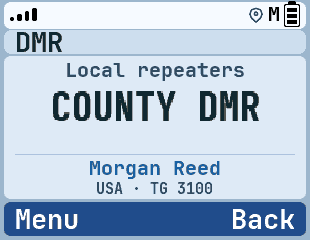
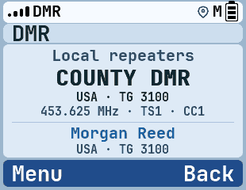

## 1. What it is for

The reference look puts as much as it can on every screen in small, plain type. That serves a user who wants every
detail at once. The panels look serves the user who operates in the field: a glance at arm's length, gloves, sunlight
or a dark cab, a radio that is mostly used to talk on a few channels. It trades density for legibility and for a
fixed place for each kind of information (P5), and it keeps every function: nothing is hidden by the look or by the
Home layout (P1, P10).

## 2. Rounded panes

Every screen is built from rounded, tinted panes: the status strip, each list row and grid tile, the soft key bar,
and on Home the mode bar and the channel pane, all on a background that shows between them.

- **Regions you can find without reading.** A pane is a region with one job (P5). The strip is always the top pane and
  the soft key bar always the bottom one, on every screen, so the eye goes to the same place for the same answer.
- **Rows that separate themselves.** A gap between two row panes separates the rows better than a line or more
  spacing would, so rows can be large (26 px on 310 x 240, five rows) and still read as a list.
- **Focus you can't miss.** The focused row is filled and has a solid accent bar at its rounded left end: a shape, not
  only a color, so it reads in sunlight, at night and to a color-blind user (P5). The bar is drawn, not a "|"
  character, so it never shifts the text.
- **One row height everywhere.** A list never changes its rhythm from screen to screen, and the position badge "n/N"
  in the title row says how long the list is without a scroll bar.

## 3. The status strip

The strip is the answer to "is the radio talking or listening, and is it OK" on every screen, menus included (P2).

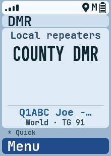
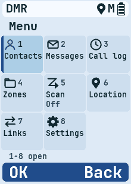

- **The same strip on every screen.** The same marks at the same size in the same places, so a user learns it once.
  On the full layout Home's strip leaves the mode out, because Home's mode bar shows it in large type; that is the
  only difference.
- **Marks, not abbreviations.** Battery, signal, lock, GPS, unread mail, monitor, scan, roaming and privacy are drawn
  marks from one family (section 7). Words stay where a word is clearer than a picture: the mode (DMR, FM), TX and NO
  TX, IP, RX for a receive-only channel, VOX, the power letter.
- **Left is the air, right is the radio.** The left side says what is on the air: signal bars (only while something
  is received, so bars always mean "hearing something now"), the mode, roaming, TX or NO TX, the monitor, dual watch,
  VOX. The right side says the radio's own state from the edge in: battery, power, lock, GPS, the USB network, then
  the operating marks (unread mail, the privacy key, receive-only, scan).
- **A ranking, never an overlap.** A busy strip can't hold every mark. Instead of shrinking or overlapping, each
  item gets room in a fixed order of importance and the least important give way first: battery, TX / NO TX, signal,
  mode, lock, privacy key, scan, monitor, unread mail, then the GPS clock, GPS, IP, power, receive-only, VOX, dual
  watch, roaming. What PTT will do and whether the radio is OK (P2) never gives way to a convenience. Before anything
  goes, the words drop from 12x24 to 8x16.
- **The GPS clock** (Settings > Display > GPS clock, off by default) shows the UTC date and time while a fix supplies
  them. It is a convenience, so it ranks after the operating states, and on Home, where the strip is full, it moves to
  the mode bar rather than disappearing.
- **The privacy key** shows that privacy is configured, in the ink like every mark. A dimmed key under a red slash
  says the one thing worth a color: encrypted traffic the radio can't decrypt.

## 4. Home

Home answers where am I, what will PTT do, what is happening and is the radio OK (P2, P5). The panels Home answers the
first two with two large lines and keeps the rest in fixed places.

- **The channel name is the main line.** The channel's name from the codeplug is the largest text on Home, with the
  zone above it. Users program their channels with names that mean something to them ("County fire", "Local
  repeater"); the name is what they look for. In the VFO the main line is the frequency.
- **The mode bar** under the strip shows the mode in the largest font: DMR or FM decides what PTT does and how the
  radio sounds, so it gets its own bar instead of a word among the marks.
- **Two layouts, one radio.** Settings > Display > Display profile chooses how much Home shows. Both have the same
  keys, menus and functions; only Home's channel pane differs.

| | Commercial (the default) | Amateur |
|---|---|---|
| For | A radio programmed for the user, channels that each mean one talkgroup | A user who changes talkgroups, frequencies and repeaters |
| Main line | The channel name, larger | The channel name |
| Talk target | Only when it isn't the channel's own | Always, with its number |
| Details row | No | Frequency, timeslot, color code, a dot for a temporary change |

- **The talk-target rule.** On a radio programmed like a commercial fleet, a channel stands for its talkgroup: showing
  "TG 3100" under "County fire" every time adds nothing, and a line that is always there stops being read. So
  Commercial shows the talk target only when PTT would go somewhere other than the channel's own target: a target
  chosen for now, the reply window's, a one-shot call's, or the VFO's (whose main line is a frequency and names no
  target). The line appearing is itself the alert that PTT goes elsewhere (P2). Amateur always shows it, because there
  the target changes often and is part of where you are.
- **Talkgroup name first.** A name is what fits a small screen and what a user recognizes, so a radio that starts in
  the panels look starts with Talkgroup name first on ("USA · TG 3100"). The setting and the TG name / number key work
  the same in both looks.
- **Call lines that keep their place.** Two lines under a rule at the foot of the channel pane show the caller (the
  talker alias, the contact's name or the ID) and the talkgroup during a call, where PTT talks to and the time left
  while transmitting, or what needs attention when idle (a refused PTT's reason, No TX frequency). They keep their
  place, so nothing above them moves when a call comes in: the main line stays where the eye left it.
- **Dual watch** keeps its two-pane view inside Home's frame, with the calls heard under the panes as the original look
  lists them: the newest two where the full layout has room (three in Commercial on the 220 x 310 screen), the newest
  one in the compact layout. The panes' padding and the gap between them give way for those lines. A caller coming in
  is named in their pane in both profiles. Trunked and single-frequency repeater channels keep
  their own operating views under the same strip and bar, since they show states (the control channel, the grant) a
  channel Home has no place for.

## 5. The 3x3 grids

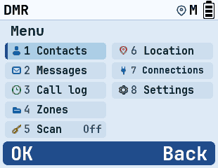
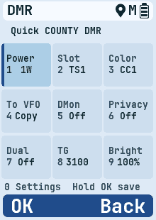

Menu and Quick settings are 3 x 3 grids of tiles laid out like the number keys: 1 2 3 on the top row, 7 8 9 on the
bottom. The position of a tile on the screen is the position of its key on the keypad, so the screen teaches the key
and the key confirms the screen (P1, P6). Each tile keeps its digit in every build and on every radio, so muscle memory
carries over. Up and Down follow the numbers.

- **Menu tiles** have an icon, the digit and the label, and a value where one helps (Messages "1 new", Scan "On").
  Zones shows no value: Home already shows the zone, and the tile has more use for room than for a repeat.
- **Quick tiles** have their name in whole words (Brightness, Color code, TX frequency) and their value under the
  digit, between arrows while it edits. A typed TX frequency shows in its tile as it is typed.
- **Settings' first level** is two columns of three tiles, because its ten groups don't fit a 3 x 3 page and a two-line
  label ("Security & keypad lock") needs the width.

## 6. The hint row and the soft key bar

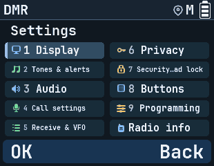

- **Two labels, one per soft key.** The bottom bar names exactly the two soft keys, OK on the left and Back on the
  right (on Home, Menu and the right soft key's function), in the largest font that fits, under the keys they name.
  Two large words are read at a glance; a row of six small hints is not.
- **The hint row says only what the bar can't.** The line above the bar lists the other keys (#, \*, the digits, PTT,
  a key held) and what OK or Back do when it isn't their usual job: "OK save  Back cancel" in a value editor, "Back
  stop scan", "OK send". A plain "OK open" in a list repeats the bar, so it isn't shown; every hint that remains is
  news. This follows P8 and P9: each press is explained, but nothing the user already sees is said twice.
- **Hint row off hides only the hint row.** The bar stays, because it is how the two soft keys are labeled.
- **Keys locked.** Home's bar says how to unlock the keys in large text, in place of the labels, because nothing else
  works until then (P8: a press that does nothing explains itself).
- **The same in every language.** Which key a hint names is read from its structure (a group that starts with OK or
  Back), never from translated words, so the bar and the row are right in every language.

## 7. The icon family and what color means

- **One family.** Every icon on a tile and the strip's pictured marks (lock, GPS, unread mail, monitor, scan,
  roaming, the privacy key) are drawn on one grid (a 24 px canvas, 20 px of ink, 2 px strokes) in one ink. The signal
  bars and the battery are drawn in code at the strip's scale, in the same ink. Icons that share a stroke and a size
  read as a set and don't compete with the text.
- **Pictures for meaning, drawn for this radio.** A person for Contacts, an envelope for Messages and unread mail, a
  clock for the call log, a folder for Zones, the zigzag for Scan (the same mark as in the strip), a pin for Location
  and GPS, two opposite arrows for Connections, a gear for Settings; in Settings a monitor, a bell, headphones (not a
  speaker, which is the monitor's mark), a handset, a tuning dial, a key, a padlock, a keypad, sliders and an "i".
  Each is drawn from first principles for this firmware.
- **Color only where it means something** (P5). Marks and icons are in the palette's ink, the focused tile's icon in
  the accent. Red is TX (and the time left while transmitting), the slash over the privacy key and a low battery;
  amber is something to act on (NO TX, a line that needs attention, an unread count, a typed or temporary value); the
  privacy blue names a caller. There are no decorative tints, so a color always carries news,
  and every color cue also has a word or a shape.

## 8. Day and Night

Settings > Display > Day/Night chooses between two palettes made for the look:

- **Day** is dark ink on a light blue-gray, for sunlight, where a dark screen mirrors the sky.
- **Night** is light ink on a dark blue-gray, for a dark cab or a night shift, where a bright screen dazzles.

Both keep the same meanings: the same ink for marks, red for TX, amber for warnings, the accent for focus. They are
one choice of two, not a palette list, because the look is tuned for these two conditions. The reference look keeps
its own Colors, Highlight color and Filled status bar settings, which the panels look doesn't need.

## 9. Large text

Large text works in both layouts (P10). It keeps the zone, the channel name and the talk target, larger, and leaves
out the details row. Throughout the look no text is smaller than 8x16: a label that doesn't fit takes a shorter word
or is shortened at its end, never a smaller font (P5). A user who needs Large text gets bigger text on Home without
losing anything the look already made legible elsewhere.

## 10. Small screens: the compact layout

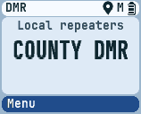
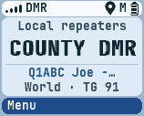
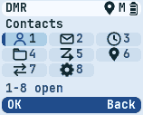
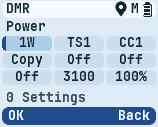

On a display under 220 pixels wide or under 200 high (down to 158 x 127) the panels look keeps its rules and gives up room, not legibility:

- **Text stays 8x16.** Every list, title, bar and hint is in 8x16, Home's channel name in 12x24. The strip is 18 px,
  rows and the bar 18 px, the icons a 0.8x set drawn from the same pictures.
- **Home** has no mode bar (the mode goes back into the strip) and no hint line. The call lines take room only during
  a call, over the target and details lines, so both Commercial and Amateur fit whole and the channel name never moves.
- **The grids keep the keypad.** Menu and Settings tiles show only their icon and digit, Quick tiles only their value;
  the title row names the focused tile and its value. The grid still maps to the keys, which is what the grid is for.
- **A list gets the hint row's room** when the row has nothing to say, for one more row.
- **The focused row slides.** A label too long for its row rests shortened, then slides sideways to show its end, then
  rests again. Only the focused row moves, only in a list, and only where the text doesn't fit; Home never scrolls
  text (P5).
- **No GPS clock.** The strip has no room for it beside the operating states, and Home has no mode bar to move it to.
- **Shorter words before cut words.** Labels have short forms written for narrow screens ("Links" for Connections on a
  tile, "Profile" for Display profile in a row, "Hold \* to unlock" on the locked bar), each a whole word in every
  language.

## 11. What the look does not change

The task flows, press budgets and the crawler's rules (`uiFlowTest`, [usability-tests.md](usability-tests.md)) are
the same in both looks, because the look changes no key and no menu. Find, the back stack, banners, the talk target's
lifetimes, temporary changes and their dot, and every setting behave as in the reference look. A radio offers the
panels look where its display can draw it, as the default or as a choice in Settings > Display > Theme
([feature-matrix.md](../feature-matrix.md)).
